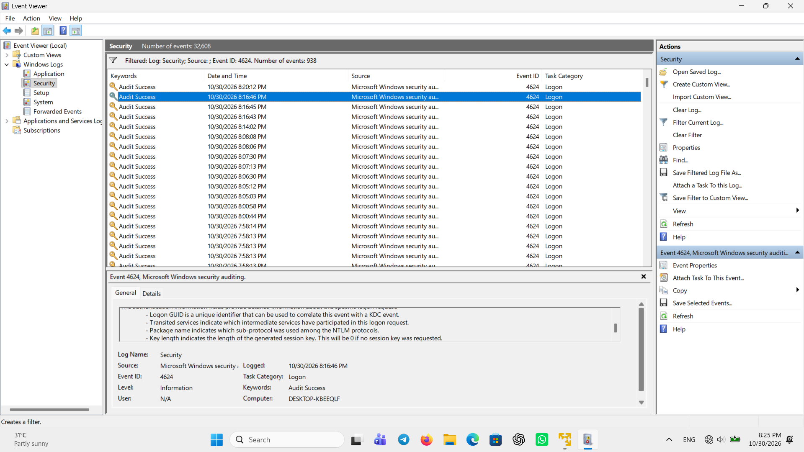

# Windows Event Log Monitoring & Analysis

Welcome to this cybersecurity portfolio project. This lab demonstrates hands-on endpoint monitoring, log analysis, and security event triage using native Windows tools.

---

## 🛠️ Tools & Environment Used
* **Operating System:** Windows (Target Lab Environment)
* **Log Analysis Tool:** Windows Event Viewer (Security and PowerShell Operational logs)
* **Scripting / Execution:** PowerShell

---

## 📋 Key Event IDs Analyzed
* **Event ID 4624:** Successful User Logon (Logon types, user accounts, and authentication success verification)
* **Event ID 4625:** Failed User Logon (Brute-force detection, failed login attempts, and credential stuffing indicators)
* **Event ID 4104:** PowerShell Script Block Logging (Detailed script execution and command-line monitoring)
* **Event ID 4720:** User Account Creation (New user account provisioning and administrative modifications)

---

## 🔍 Lab Implementation & Evidence

### Task 1: Monitoring Successful Authentication
Analyzed Windows Security Event logs to track valid user sessions and verify logon types.
* **Evidence:**

### Task 2: Detecting Failed Authentication & Brute-Force Attempts
Identified repeated authentication failures indicating potential credential stuffing or password spraying.
* **Evidence:**

### Task 3: PowerShell Script Execution & Activity Tracking
Leveraged PowerShell script block logging to inspect administrative command line execution.
* **Evidence:**

### Task 4: Investigating User Account Provisioning
Monitored Active Directory / Local Security Authority for newly provisioned user accounts.
* **Evidence:**

---

## 💡 Key Skills Learned & Resume Highlights

* **Log Analysis & Event Investigation:** Investigated Windows Security Event Logs and authentication telemetry using Event Viewer and PowerShell.
* **Core Event ID Mastery:** Analyzed key authentication and account management Event IDs (`4624`, `4625`, `4104`, `4720`).
* **Windows Security Monitoring:** Identified anomalies in logon types, authentication failure reasons, and administrative user account modifications.

**Resume Bullet:**
> *Analyzed Windows Security Event Logs and investigated authentication-related security events using Event Viewer and PowerShell.*
