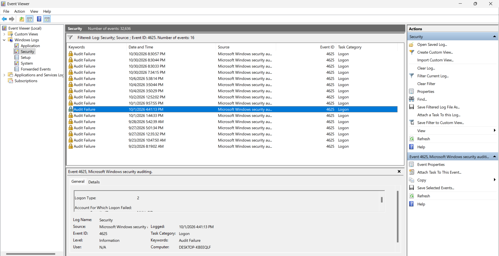
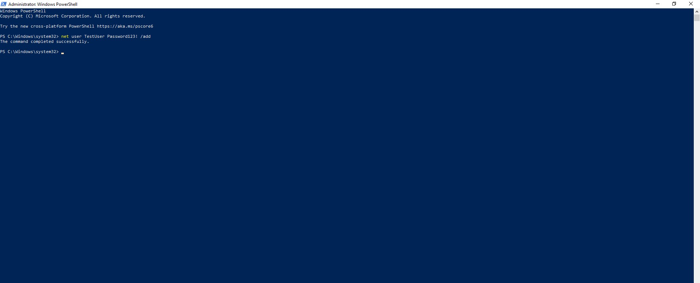
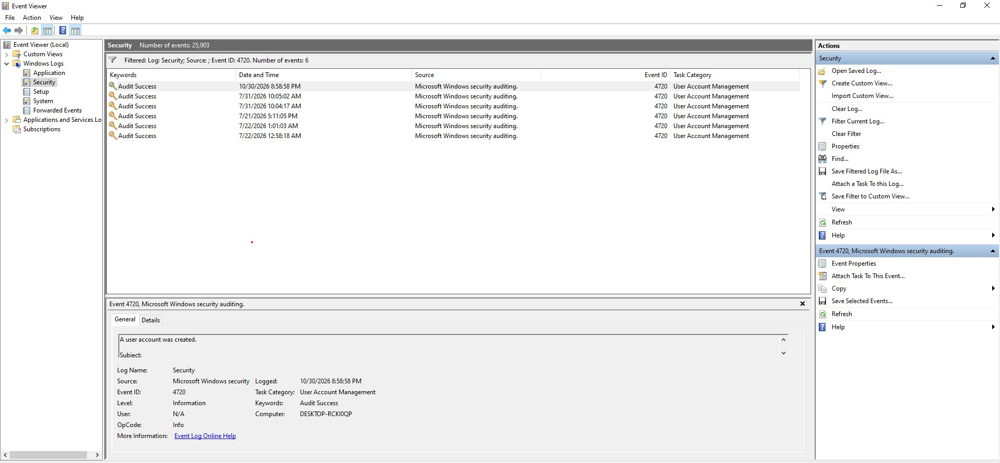

# 🛡️ SOC Level 1 Portfolio: SIEM & Threat Hunting Labs

Welcome to my cybersecurity portfolio. This repository contains hands-on SIEM projects, endpoint log analysis, threat hunting scenarios, and security incident investigations designed to demonstrate core competencies for SOC Analyst (Tier 1) roles.

---

# Project 1: Windows Event Log Monitoring & Threat Analysis

**Target Domain:** Security Operations Center (SOC) Tier 1 / Log Analysis & Threat Detection  
**Author:** SOC Analyst Candidate  

---

## 🎯 Executive Summary & Objective
This project demonstrates essential Tier 1 SOC Analyst technical skills: extracting, analyzing, and interpreting endpoint security telemetry from Windows systems. Using native **Windows Event Viewer** (`eventvwr.msc`) and **System Monitor (Sysmon)**, this lab establishes baseline authentication behaviors, identifies anomalous logon attempts, and tracks account state modifications.

---

## 🛠️ Infrastructure & Security Tools
* **Endpoint Architecture:** Windows Virtual Machine (VM)
* **Telemetry Generators:** Windows Security Log Subsystem, Sysmon
* **Analysis & Inspection Interface:** Windows Event Viewer, Windows PowerShell

---

## 🔬 Implementation Tasks & Evidence Mapping

### Task 1: Tracking Successful Authentication Events
Monitored successful logons to verify authorized access patterns and detect anomalies such as unexpected logon types or off-hours activity.

* **Target Rule/Event:** `Event ID 4624` — *An account was successfully logged on*
* **Key Fields Analyzed:** `TargetUserName`, `LogonType`, `IpAddress`, `WorkstationName`

  
*Figure 1.1: Windows Event Viewer detailed view displaying Event ID 4624 confirming successful user authentication.*

---

### Task 2: Detecting Failed Authentication & Brute-Force Attempts
Identified repeated authentication failures indicating potential credential stuffing, password spraying, or unauthorized brute-force attempts targeting local accounts.

* **Target Rule/Event:** `Event ID 4625` — *An account failed to log on*
* **Key Fields Analyzed:** `TargetUserName`, `FailureReason`, `SubStatus`, `WorkstationName`

  
*Figure 2.1: Event ID 4625 capture highlighting authentication failure details.*

---

### Task 3: Simulating User Provisioning via PowerShell
Executed local account provisioning via PowerShell (`net user TestUser Password123! /add`) to simulate suspicious account creation and generate operational telemetry.

  
*Figure 3.1: Administrative PowerShell terminal executing user account creation command.*

---

### Task 4: Monitoring Local Account Creation (Persistence Detection)
Monitored local administrative modifications in Event Viewer to detect unauthorized accounts created for persistent access.

* **Target Rule/Event:** `Event ID 4720` — *A user account was created*
* **Key Fields Analyzed:** `SAMAccountName`, `SubjectUserName` (Account Creator), `UserSid`

  
*Figure 4.1: Audit evidence capturing Event ID 4720 detailing new user account provisioning in Event Viewer.*

---

## 💡 Key Skills Learned & Resume Highlights
* **Log Analysis & Threat Triage:** Investigated Windows Security Event logs and telemetry using Event Viewer and Sysmon.
* **Core Event ID Mastery:** Analyzed key authentication and account management Event IDs (`4624`, `4625`, `4720`).
* **Windows Security Monitoring:** Identified anomalies in logon types, failure reasons, and administrative user modifications.

> **Resume Bullet:**  
> *Analyzed Windows Security Event Logs and investigated authentication-related events using Event Viewer and Sysmon.*
